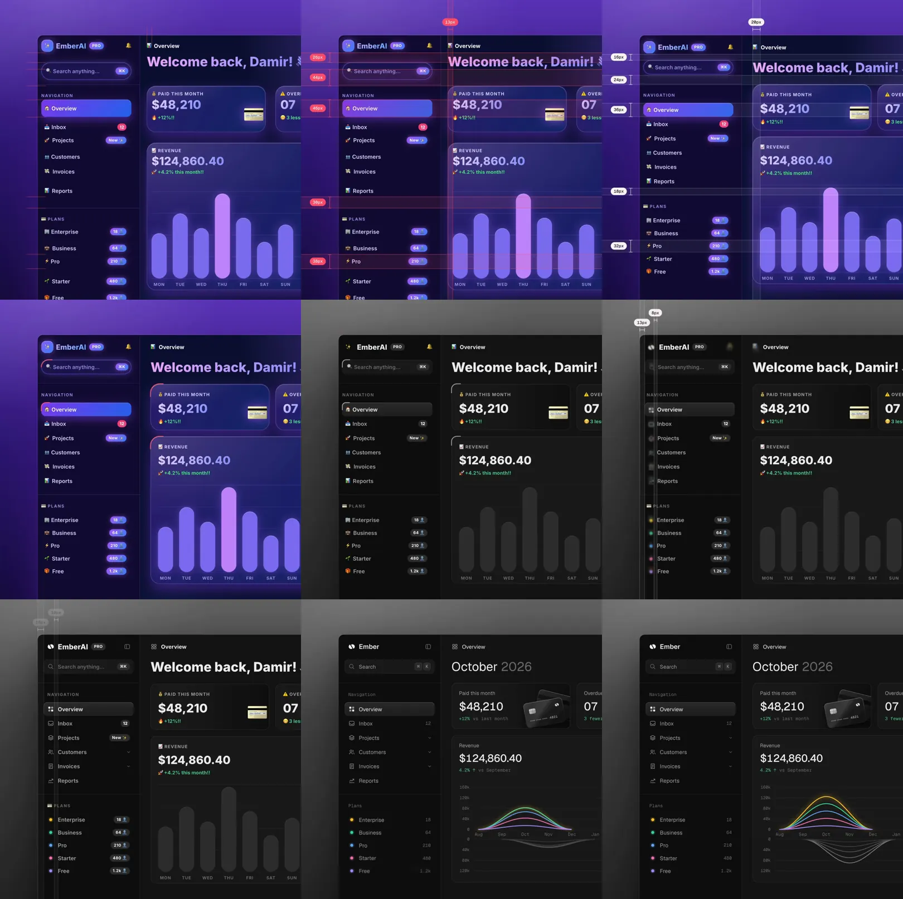

# unslop (portable)

A portable build of [heydamir/unslop](https://github.com/heydamir/unslop) that works in Claude Code, OpenAI Codex, opencode, Google Antigravity and any other agent that reads the `SKILL.md` open format.

unslop turns vibecoded, AI-looking UI into a designed interface with its own character. It finds the slop first — the purple gradients, glows, emoji labels, shouty copy and uneven spacing — then sets a direction from your product and fixes the screen pass by pass, like a designer doing a redline review. It works in whatever your screen is built with: Next.js, React, Vue, Svelte, Tailwind or plain HTML and CSS, on dashboards, apps and landing pages, and even on a live site when all you have is a link.



## Install

One command installs the skill once under `~/.agents/skills/unslop` and links it into every agent's skills folder:

**Windows (PowerShell)**

```powershell
git clone https://github.com/ardaozyildirim/unslop-multiagent
cd unslop-multiagent
powershell -ExecutionPolicy Bypass -File .\install.ps1
```

**macOS / Linux**

```bash
git clone https://github.com/ardaozyildirim/unslop-multiagent
cd unslop-multiagent
./install.sh
```

Or place the folder yourself:

| Agent | Global | Project |
| --- | --- | --- |
| Claude Code | `~/.claude/skills/unslop/` | `.claude/skills/unslop/` |
| OpenAI Codex | `~/.codex/skills/unslop/` (also reads `~/.agents/skills/`) | `.agents/skills/unslop/` |
| opencode | `~/.config/opencode/skills/unslop/` (also reads `~/.agents/skills/` and `~/.claude/skills/`) | `.opencode/skills/unslop/` or `.agents/skills/unslop/` |
| Antigravity | IDE: `~/.gemini/config/skills/unslop/`, CLI: `~/.gemini/antigravity-cli/skills/unslop/` (copied, not linked) | `.agents/skills/unslop/` |

Each entry is the whole `skills/unslop` folder, with `SKILL.md`, `references/` and `scripts/`.

## Use

- **Claude Code:** `/unslop this dashboard`
- **Codex, opencode, Antigravity:** `use the unslop skill on this dashboard`

Point at a file, a live URL or a screenshot. The skill audits the screen and proposes a direction before it edits anything. If the screen is already good, it says so and suggests a few small refinements instead of redesigning it.

It can also render a square story video of the screen unslopping itself, ready to post.

## What it does

- **Audit.** Lists every sign of slop with where it lives.
- **Direction.** Character, world, the one or two moments that carry the color, and a signature detail, all taken from your product.
- **Passes.** Spacing, color, icons, copy, type, layout, details, visuals and motion, in that order.
- **Visuals.** Shows your product instead of a glossy blob. When a hero needs a scene or an object, it can generate one through your agent's image tool or an MCP image service. It shows the prompt and asks before every paid generation. Dashboards and apps rarely need one.
- **Story video.** A square video under 10 seconds of your screen unslopping itself, ready to post. It needs Playwright and ffmpeg.

Try it on the two vibecoded screens in [examples](examples).

## Requirements

- **Node 18+** for the two scripts.
- **Playwright** only for live-site snapshots (`snapshot.mjs`). `npx playwright install chromium` is enough, or set `CHROME_PATH` to an existing Chrome or Edge.
- **ffmpeg** only for the story video (`story.mjs`).
- **Image generation is optional.** Use your agent's image tool or connect an MCP image service (fal, Replicate, OpenAI images, Higgsfield). The skill asks before every paid generation.

## What this port changes

The method, references and examples are unchanged. Only portability changed:

- `SKILL.md`: added `compatibility` metadata, per-agent invocation notes and a requirements section.
- `scripts/snapshot.mjs`, `scripts/story.mjs`: detect Chrome and Edge on Windows as well as macOS and Linux, and give platform-neutral install hints.
- Added `install.ps1`, `install.sh` and per-agent install docs.
- Kept the upstream credit in every file, as CC BY 4.0 requires.

Pull requests for the method itself belong in [upstream](https://github.com/heydamir/unslop); this repo only tracks the port.

## Credit and license

unslop was created by Damir Sokolovsky ([@heydamir](https://x.com/heydamir)) and is licensed under [CC BY 4.0](LICENSE). Use it, change it and share it, including commercially, as long as you credit Damir Sokolovsky and link back to [the original repository](https://github.com/heydamir/unslop). This port by [@ardaozyildirim](https://github.com/ardaozyildirim).
