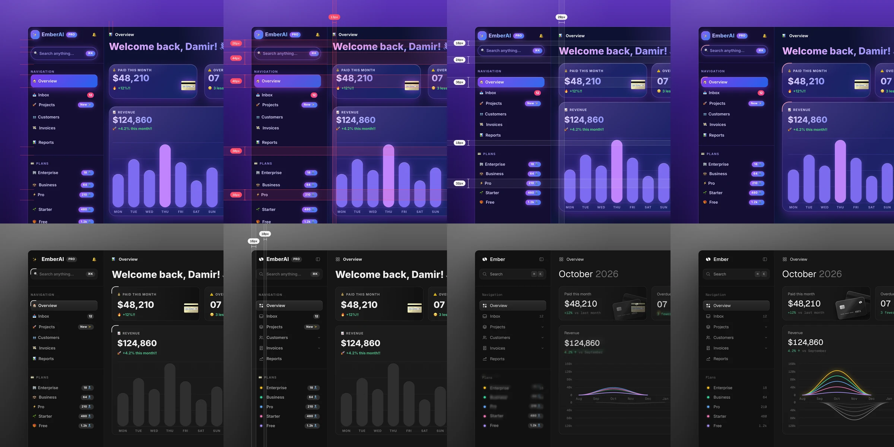

# unslop-portable

> **This is an unofficial port.** It is not affiliated with, endorsed by, or supported by the original author. The canonical skill is [heydamir/unslop](https://github.com/heydamir/unslop) — install that one if you want the upstream version. This port exists because the skill only shipped for Claude Code, and it is published under the same CC BY 4.0 terms with the original credit kept.

A portable build of [heydamir/unslop](https://github.com/heydamir/unslop) that works in Claude Code, OpenAI Codex, opencode, Google Antigravity and any other agent that reads the `SKILL.md` open format.

unslop turns vibecoded, AI-looking UI into a designed interface with its own character. It finds the slop first — the purple gradients, glows, emoji labels, shouty copy and uneven spacing — then sets a direction from your product and fixes the screen pass by pass, like a designer doing a redline review. It works in whatever your screen is built with: Next.js, React, Vue, Svelte, Tailwind or plain HTML and CSS, on dashboards, apps and landing pages, and even on a live site when all you have is a link.



## Install

One command installs the skill once under `~/.agents/skills/unslop-portable` and links it into every agent's skills folder:

**Windows (PowerShell)**

```powershell
git clone https://github.com/ardaozyildirim/unslop-portable
cd unslop-portable
powershell -ExecutionPolicy Bypass -File .\install.ps1
```

**macOS / Linux**

```bash
git clone https://github.com/ardaozyildirim/unslop-portable
cd unslop-portable
./install.sh
```

Or place the folder yourself:

| Agent | Folder |
| --- | --- |
| Claude Code | `~/.claude/skills/unslop-portable/SKILL.md` |
| OpenAI Codex | `~/.codex/skills/unslop-portable/SKILL.md` |
| opencode | `~/.config/opencode/skills/unslop-portable/SKILL.md` |
| Google Antigravity | `~/.gemini/antigravity-cli/skills/unslop-portable/SKILL.md` |

The skill is named `unslop-portable` on purpose. The upstream skill is named `unslop`, and two skills cannot share a name: installing both would make one overwrite the other, and the two would fight over the same slash command. With a distinct name both live side by side.

If you installed an earlier build of this port that used the name `unslop`, remove it before installing this one:

```bash
rm -rf ~/.agents/skills/unslop ~/.claude/skills/unslop ~/.codex/skills/unslop \
       ~/.config/opencode/skills/unslop ~/.gemini/config/skills/unslop \
       ~/.gemini/antigravity-cli/skills/unslop
```

## Use it

- **Claude Code.** Type `/unslop-portable` and name the screen, or just ask in your own words.
- **OpenAI Codex, opencode, Antigravity.** Name the skill in the request, like `use the unslop-portable skill on this dashboard`, and point at the screen.

The screen can be a file path, a live URL, or a screenshot.

## What this port changes

The method is unchanged. Every reference file, the example dashboard and the LICENSE are byte-identical to upstream. This port only adds the things upstream needed to exist outside Claude Code:

- **Cross-agent install.** `install.sh` and `install.ps1` link the skill into the Claude Code, Codex, opencode and Antigravity folders. Antigravity gets a real copy instead of a link, because it does not follow symlinks.
- **Windows browser discovery.** `scripts/snapshot.mjs` and `scripts/story.mjs` find Chrome and Edge on Windows, and look for `google-chrome-stable` and `chromium-browser` on Linux.
- **Agent-neutral front matter.** The `compatibility` field and the "Using this skill" section describe how to invoke the skill in each agent.
- **A distinct name.** The skill, the folder and the repository are called `unslop-portable`, so it can live next to upstream `unslop` without a collision. `CITATION.cff` credits both Damir Sokolovsky and this port, and points at the upstream repository.

Everything else is upstream's work, kept intact.

## Keeping it in sync with upstream

This is a snapshot of upstream, so it does not follow new commits there. To pull in upstream changes:

```bash
git remote add upstream https://github.com/heydamir/unslop
git fetch upstream
git rebase upstream/main
```

The rebase usually needs one manual fix: upstream keeps the skill in `skills/unslop/`, this port keeps it in `skills/unslop-portable/`. Rename the folder in the incoming commit and update the `name:` field in the front matter, or merge the content and reapply this port's `SKILL.md` header.

## Credits

unslop was created by Damir Sokolovsky ([@heydamir](https://x.com/heydamir)) and is licensed under [CC BY 4.0](LICENSE). Use it, change it and share it, including commercially, as long as you credit Damir Sokolovsky and link back to [the original repository](https://github.com/heydamir/unslop). This port by [@ardaozyildirim](https://github.com/ardaozyildirim).

The portable build for Claude Code, OpenAI Codex, opencode and Google Antigravity was written by [@ardaozyildirim](https://github.com/ardaozyildirim). The method is unchanged.
